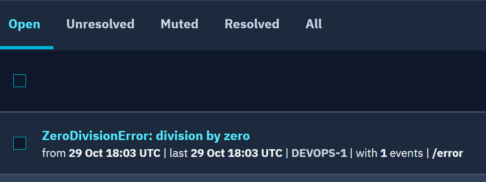

# Деплой приложения на PaaS (Devops)

[](https://github.com/temeka1221/devops-engineer-from-scratch-project-313/actions) [](https://github.com/temeka1221/devops-engineer-from-scratch-project-313/actions/workflows/ci.yml)

Создайте и задеплойте веб-приложение, подключите базу данных и настройте мониторинг ошибок

Учебный проект Хекслета: https://ru.hexlet.io/programs/devops-engineer-from-scratch

## Демо

- Приложение: https://devops-engineer-from-scratch-project-313-utep.onrender.com
- Проверка работы: https://devops-engineer-from-scratch-project-313-utep.onrender.com/ping
- Документация API (Swagger UI): https://devops-engineer-from-scratch-project-313-utep.onrender.com/docs

## Стек

- Python 3.14, FastAPI, uvicorn
- PostgreSQL 18, SQLModel
- uv: зависимости и окружение
- pytest, Ruff: тесты и линтер
- Docker, Docker Compose: сборка образа и локальная база
- Render: хостинг приложения и базы
- GitHub Actions: CI
- Bugsink через Sentry SDK: мониторинг ошибок

## Требования

- [uv](https://docs.astral.sh/uv/getting-started/installation/)
- make
- Docker с плагином Compose: локальная база и сборка образа

## Установка

```bash
git clone https://github.com/temeka1221/devops-engineer-from-scratch-project-313.git
cd devops-engineer-from-scratch-project-313
cp .env.example .env
make install
```

Поднять PostgreSQL и создать базу для тестов:

```bash
docker compose up -d
docker compose exec db createdb -U SecretUser appdb_test
```

База слушает только `127.0.0.1:5432`. Данные хранятся в томе `dbdata` и переживают перезапуск контейнера.

## Переменные окружения

Шаблон со всеми переменными лежит в `.env.example`. Локально они читаются из `.env`, на Render задаются в настройках сервиса.

- `DATABASE_URL`: обязательная, адрес PostgreSQL. Принимает схемы `postgres://` и `postgresql://`
- `BASE_URL`: обязательная, адрес сайта, из него собирается `short_url`
- `TEST_DATABASE_URL`: нужна только для тестов. Отдельная база: тесты создают и удаляют в ней таблицы
- `PORT`: порт приложения при запуске в Docker, по умолчанию `8080`. `make run` всегда слушает 8080
- `SENTRY_DSN`: DSN проекта в Bugsink, по умолчанию не задана. Без нее мониторинг выключен, приложение работает как обычно

## API

| Метод | Путь | Описание | Успешный ответ |
|---|---|---|---|
| GET | `/api/links` | список ссылок | 200 |
| POST | `/api/links` | создать ссылку | 201 |
| GET | `/api/links/{id}` | получить ссылку | 200 |
| PUT | `/api/links/{id}` | обновить ссылку | 200 |
| DELETE | `/api/links/{id}` | удалить ссылку | 204 |
| GET | `/r/{short_name}` | перейти по короткой ссылке | 302 |

Ошибки отдаются в JSON с полем `detail`: 404 если ссылки нет, 409 если `short_name` уже занят, 422 если тело запроса невалидно.

Пример:

```bash
curl -X POST localhost:8080/api/links -H 'Content-Type: application/json' \
  -d '{"original_url": "https://example.com/", "short_name": "exmpl"}'
```
```json
{"id": 1, "original_url": "https://example.com/", "short_name": "exmpl", "short_url": "http://localhost:8080/r/exmpl"}
```

Таблицы создаются автоматически при старте приложения.

## Использование

### Локально

```bash
make run
```
Запускает приложение на порту 8080. База должна быть поднята через `docker compose up -d`.

```bash
curl -s localhost:8080/ping; echo
```
Ожидаемый ответ: `pong`

### В Docker

```bash
docker build -t project-313 .
docker run --rm -p 8080:8080 \
  --network devops-engineer-from-scratch-project-313_default \
  -e DATABASE_URL=postgres://SecretUser:SecretPwd21@db:5432/appdb \
  -e BASE_URL=http://localhost:8080 \
  project-313
```
Контейнер подключается к сети Compose и обращается к базе по имени сервиса `db`: `localhost` внутри контейнера указывает на сам контейнер, а не на хост.

### Разработка

```bash
make test     # тесты, нужна поднятая база и TEST_DATABASE_URL
make lint     # проверка линтером и форматтером, без изменений
make format   # автоисправление форматирования и импортов
```

GitHub Actions запускает `make lint` и `make test` на каждый push в `main` и на каждый pull request. Для тестов в CI поднимается PostgreSQL как сервисный контейнер.

## Деплой

Приложение развернуто на Render: Web Service из `Dockerfile` и Render PostgreSQL в том же регионе. В сервисе заданы `DATABASE_URL` (Internal Database URL базы), `BASE_URL` и `SENTRY_DSN`. Деплой запускается автоматически после зеленого CI в `main`.

## Мониторинг ошибок

Ошибки приложения отправляются в Bugsink через Sentry SDK. DSN берется из переменной `SENTRY_DSN` и в коде не хранится.

Для проверки есть маршрут `/error`, он вызывает `ZeroDivisionError`. Клиент получает `500 Internal Server Error` без подробностей, а полный traceback приходит в Bugsink:

```bash
curl -i https://devops-engineer-from-scratch-project-313-utep.onrender.com/error
```



<details>
<summary>Автоматические тесты Хекслета</summary>

Тесты запускаются на каждый коммит. За запуск отвечает файл `.github/workflows/hexlet-check.yml`, не удаляйте и не переименовывайте ни его, ни репозиторий.

</details>

## О Хекслете

[Хекслет](https://ru.hexlet.io/) это школа программирования: авторские программы обучения с практикой, поддержкой наставников и реальными проектами, которые остаются в резюме. Этот репозиторий один из таких проектов.