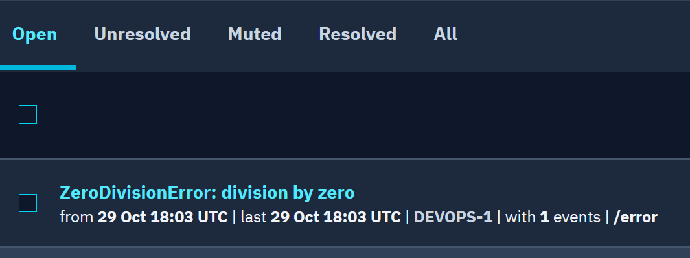

# Деплой приложения на PaaS (Devops)

[](https://github.com/temeka1221/devops-engineer-from-scratch-project-313/actions) [](https://github.com/temeka1221/devops-engineer-from-scratch-project-313/actions/workflows/ci.yml)

Создайте и задеплойте веб-приложение, подключите базу данных и настройте мониторинг ошибок

Учебный проект Хекслета: https://ru.hexlet.io/programs/devops-engineer-from-scratch

## Демо

- Приложение: https://devops-engineer-from-scratch-project-313-utep.onrender.com
- Проверка работы: https://devops-engineer-from-scratch-project-313-utep.onrender.com/ping
- Документация API (Swagger UI): https://devops-engineer-from-scratch-project-313-utep.onrender.com/docs

## Стек

- Python 3.14, FastAPI, uvicorn
- uv: зависимости и окружение
- pytest, Ruff: тесты и линтер
- Docker, Render: сборка и хостинг
- GitHub Actions: CI
- Bugsink через Sentry SDK: мониторинг ошибок

## Требования

- [uv](https://docs.astral.sh/uv/getting-started/installation/)
- make
- Docker, для запуска в контейнере

## Установка

```bash
git clone https://github.com/temeka1221/devops-engineer-from-scratch-project-313.git
cd devops-engineer-from-scratch-project-313
make install
```

## Переменные окружения

- `PORT`: порт приложения при запуске в Docker, по умолчанию `8080`. `make run` всегда слушает 8080
- `SENTRY_DSN`: DSN проекта в Bugsink, по умолчанию не задана. Без нее мониторинг выключен, приложение работает как обычно

## Использование

### Локально

```bash
make run
```
Запускает приложение на порту 8080.

```bash
curl -s localhost:8080/ping; echo
```
Ожидаемый ответ: `pong`

### В Docker

```bash
docker build -t project-313 .
docker run --rm -p 8080:8080 project-313
```
Собирает образ и запускает контейнер. Переменные передаются через `-e`, например `-e SENTRY_DSN=...`

### Разработка

```bash
make test     # тесты
make lint     # проверка линтером и форматтером, без изменений
make format   # автоисправление форматирования и импортов
```

На каждый push в `main` GitHub Actions запускает `make lint` и `make test`.

## Мониторинг ошибок

Ошибки приложения отправляются в Bugsink через Sentry SDK. DSN берется из переменной `SENTRY_DSN` и в коде не хранится.

Для проверки есть маршрут `/error`, он вызывает `ZeroDivisionError`. Клиент получает `500 Internal Server Error` без подробностей, а полный traceback приходит в Bugsink:

```bash
curl -i https://devops-engineer-from-scratch-project-313-utep.onrender.com/error
```



<details>
<summary>Автоматические тесты Хекслета</summary>

Тесты запускаются на каждый коммит. За запуск отвечает файл `.github/workflows/hexlet-check.yml`, не удаляйте и не переименовывайте ни его, ни репозиторий.

</details>

## О Хекслете

[Хекслет](https://ru.hexlet.io/) это школа программирования: авторские программы обучения с практикой, поддержкой наставников и реальными проектами, которые остаются в резюме. Этот репозиторий один из таких проектов.